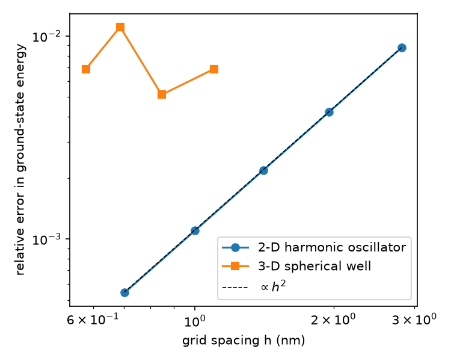
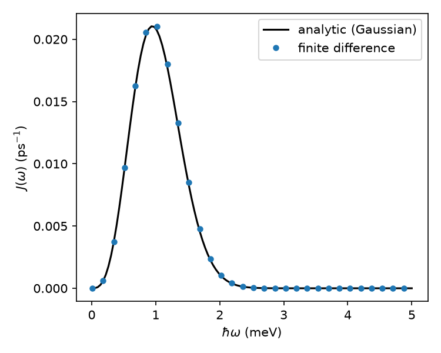
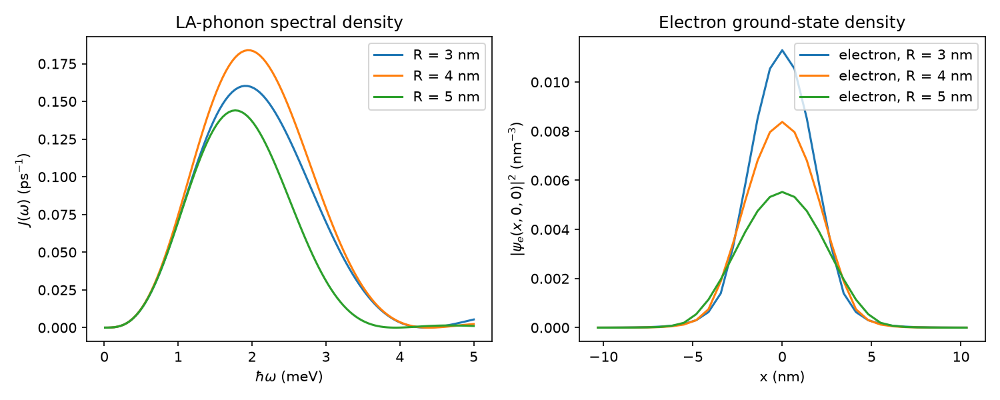

# qd-phonon-fd

Finite-difference model of a semiconductor quantum dot and the acoustic-phonon spectral
density that sets its phonon-induced dephasing.

The project does two things:

1. **Solves the effective-mass Schrödinger equation** for electron and hole states in a
   quantum dot. The solver uses second-order finite differences on a uniform 1-D, 2-D or
   3-D grid and finds the lowest states with a sparse shift-invert eigensolver.
2. **Computes the LA-phonon spectral density J(ω)** for deformation-potential coupling
   directly from the computed wavefunctions. It does this through the electron and hole
   form factors, averaged over phonon directions.

Every numerical result is checked against a case with a known exact answer before being
used on a case without one.

## Physics

Hamiltonian, constant effective mass per carrier, with ψ = 0 on the box walls:

$$H = -\frac{\hbar^2}{2m^*}\nabla^2 + V(\mathbf r)$$

Spectral density for an exciton coupled to longitudinal-acoustic phonons. ρ is the mass
density and c the LA sound velocity:

$$J(\omega) = \frac{\omega^3}{4\pi^2\rho\hbar c^5}\,\Big\langle \big|D_e F_e(\mathbf q) - D_h F_h(\mathbf q)\big|^2 \Big\rangle_{\hat{\mathbf q}},
\qquad F(\mathbf q) = \int |\psi(\mathbf r)|^2 e^{i\mathbf q\cdot\mathbf r}\,d^3r,\quad q = \omega/c$$

For Gaussian densities $|\psi|^2 \propto e^{-r^2/\ell^2}$ this reduces to the standard closed
form:

$$J(\omega) = \frac{\omega^3}{4\pi^2\rho\hbar c^5}\left(D_e e^{-q^2\ell_e^2/4} - D_h e^{-q^2\ell_h^2/4}\right)^2$$

The project uses the closed form as a reference.

GaAs parameters: ρ = 5370 kg/m³, c = 5110 m/s, D_e = −14.6 eV, D_h = −4.8 eV. These are
values commonly used in the quantum-dot dephasing literature, for example Krummheuer, Axt and
Kuhn, PRB 65, 195313 (2002).

## Validation

| Check | Result |
|---|---|
| 1-D infinite well, first 4 levels | matches n²π²ħ²/2mL² to 0.1% |
| 1-D harmonic oscillator, first 5 levels | matches (n + ½)ħω to 0.1% |
| 2-D oscillator degeneracies (1, 2, 3) | reproduced |
| Convergence order, 2-D oscillator | **2.01** (expected 2) |
| 3-D finite spherical well vs exact k cot(kR) = −κ | **0.7%** error at h = 0.58 nm |
| Form factor of a Gaussian density | matches e^{−q²ℓ²/4} to 10⁻⁶ |
| J(ω) from Gaussian densities on the grid | matches the closed form to 10⁻⁴ |
| J(ω) from *solved* harmonic-trap ground states | peak within **1.1%** of the closed form |
| Polaron shift ħ∫J/ω dω | matches ħA√π ω_c³/4 to 10⁻⁴ |



**Staircase boundaries.** The spherical-well error does not fall as h²; it levels off at
about 1%. A sphere on a cubic grid has a staircase boundary, and that geometric error does
not shrink smoothly as the grid is refined. Finite-element methods solve this with meshes
that follow curved interfaces. It is the natural next step for realistic lens- or
pyramid-shaped dots.



## Result: dot-size dependence

These are spherical dots with illustrative confinement depths: 300 meV for the electron and
150 meV for the hole. The electron effective mass is 0.067, and the heavy hole is treated as
isotropic with mass 0.5.



- All dots share the same ω³ rise at low frequency, as expected. That regime depends only
  on D_e − D_h and not on dot size.
- The cutoff frequency, roughly c divided by the wavefunction size, moves up as the
  electron becomes more tightly confined.
- The peak height is **not** monotonic in R. The electron and hole densities have different
  sizes, and the coupling D_e F_e − D_h F_h partly cancels between them, so the size of each
  carrier matters and not just the dot radius.

Numbers (from `figures/results.txt`):

| R | E_e (meV) | E_h (meV) | J peak at ħω (meV) | Polaron shift, integrated to 5 meV |
|---|---|---|---|---|
| 3 nm | −54.8 | −99.3 | 1.90 | 115 µeV |
| 4 nm | −118.3 | −116.6 | 1.94 | 128 µeV |
| 5 nm | −166.7 | −127.1 | 1.77 | 98 µeV |

## Limitations and next steps

- Constant effective mass in each carrier. A position-dependent mass (BenDaniel–Duke
  boundary conditions) is the next refinement.
- The heavy hole is treated as isotropic; no strain, piezoelectric coupling or Coulomb
  interaction is included.
- Spherical dots on a cubic grid leave a staircase error of about 1%. A FEM mesh (for
  example FEniCS or COMSOL) would handle realistic lens-shaped InAs/GaAs dots.
- Only LA deformation-potential coupling is included. Piezoelectric coupling to TA phonons
  and the resulting phonon sideband and dephasing are natural extensions.

## Usage

```bash
python -m venv .venv
.venv/Scripts/python -m pip install -r requirements.txt   # Windows; use .venv/bin/python on Linux/macOS
.venv/Scripts/python -m pytest                             # 11 validation tests, about 1 minute
.venv/Scripts/python examples/run_all.py                   # figures and numbers, a few minutes
```

```python
from qdfd import Grid, solve, spherical_well, spectral_density
import numpy as np

grid = Grid.cube(31, 22.0)                                   # 31^3 points, 22 nm box
_, psi_e = solve(grid, spherical_well(grid, 4.0, 300.0), mass=0.067)
_, psi_h = solve(grid, spherical_well(grid, 4.0, 150.0), mass=0.5)
omega = np.linspace(0.01, 5.0, 100)                          # hbar*omega in meV
J = spectral_density(psi_e[0]**2, psi_h[0]**2, grid, omega)  # ps^-1
```

## Layout

```
qdfd/schrodinger.py   grid, sparse Laplacian, Hamiltonian, eigensolver, potentials
qdfd/phonons.py       form factors, J(omega), analytic Gaussian J, polaron shift
tests/                validation against exact results
examples/run_all.py   regenerates every figure and number above
```

Author: Samarth Bhaskar
